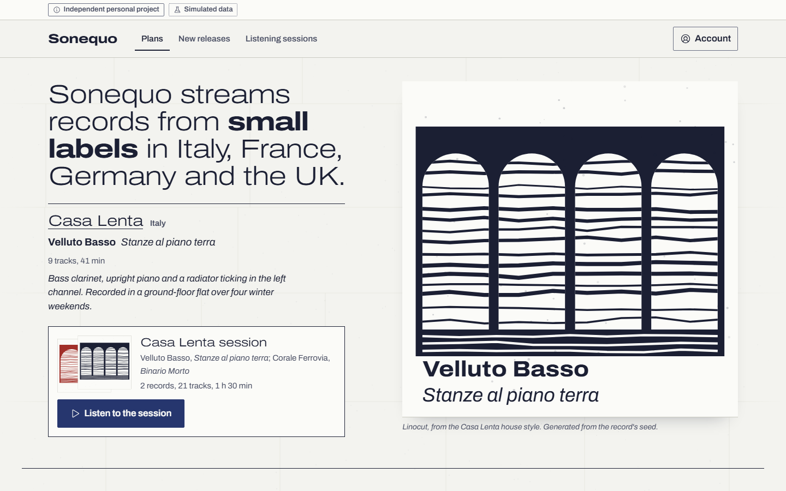
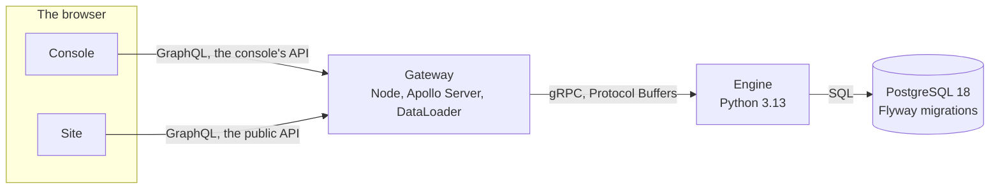
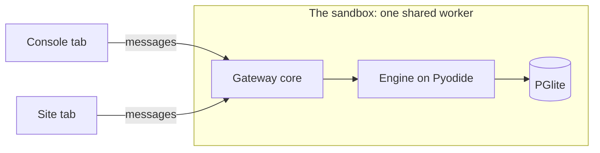

# Plancia

A subscription and pricing operations platform. A Python engine behind gRPC
keeps the rules, a GraphQL gateway serves a console for the commercial team
and a public site, and PostgreSQL holds the data and the rules that must
survive a bug. *Plancia is a provisional name.*


[The business book](docs/business.md) ·
[The contract](proto/README.md) ·
[Product status](docs/product-status.md) ·
[Production readiness](docs/production-readiness.md) ·
[Threat model](docs/threat-model.md) ·
[Legal and licensing](docs/legal-and-licensing.md) ·
[Runbook](docs/runbook.md)

Plancia keeps what a subscription business sells: the plans and what each
one includes, the price of every plan in every market, the promotions and who
they are for, prepaid passes, and price changes for the people who already
pay. Prices, promotions, passes and price changes are changes with versions.
A promotion or a price change is simulated before anyone signs it. Every
change is signed by someone other than its author, scheduled, and launched
into the public catalog by a job that publishes all of it in one transaction
or nothing, and resumes where it stopped. Every decision goes into an audit
log that can be checked afterwards, and the rules that matter most are
enforced twice, by the engine and again by the database.

The platform is explored through Rione, an independent-music streaming
service in Italy, France, Germany and the United Kingdom (a provisional name
too). Every price at Rione follows from one promise: each paying
subscription pays the artists at least €3.00 (£2.60) a month, whatever
discount the subscriber is on. A promotion below that floor costs Rione the
difference out of its own margin, so finance has to sign it, and the
simulator shows the cost before anyone does. Rione, its artists and its
subscribers are invented and the data is synthetic; the arithmetic, the
approval rules, the launches and the audit log are real. The business book
behind every feature is [docs/business.md](docs/business.md).

> Independent personal project. Fictional business and synthetic customer
> data. No real payments are processed.

## A week of Rione's commercial team, in six scenarios

Each scenario is something Rione's team does in an ordinary week, for a
business reason. Each runs in the tests against the real engine and
PostgreSQL, end to end in a headless browser, in the console, on the site or
both, and its steps are then found in the audit log.

### The Student Autumn Pass

Three months at a reduced price for verified students in Italy, new
subscribers only. Marketing creates it. The price is below the artists'
floor, so finance must approve it, and marketing cannot approve its own work,
in the interface or on the server. It goes live at 09:00 Italian time: the
site's API has it a tenth of a second later, and a page already open shows it
within seven seconds. A demo student subscribes at the right price and sees
the day the full price starts.

### The album release

An offer for Free listeners who played an artist for more than a set number
of hours in the last 30 days. Marketing finds the artist in the catalog, and
the engine counts the audience from the listening data: 35 million rows in
the full dataset, where PostgreSQL earns its place. The query is measured
before and after its index, the monthly partitions and the weekly
aggregates. On the site the offer appears only to listeners in its audience,
never to a visitor who has not signed in.

### The family price increase in Germany

New subscribers pay the new price from a date. Existing subscribers in
Germany are asked for their consent first, because German courts have struck
down terms that let a streaming service raise its price at its own
discretion. Silence never counts as a yes, and what happens without one is
Rione's own policy, set per market. In Italy, France and the United Kingdom
subscribers are told in advance and can leave before the new price applies.
The simulation shows who pays what and from when, the revenue at risk under a
declared acceptance rate, and who would move to the Free plan.

### The prepaid gift pass

Three months paid in advance, a single-use code, no renewal, untouched by
later price increases. Finance sees the value sold and not yet earned, and
nobody else does.

### Student verification

A simulated provider verifies a student. The verification expires after
twelve months, and discounts that do not combine never stack.

### The safe launch

A launch is cut off in the middle and resumes from the step it reached, so
the site never shows half a catalog, and the console shows what happened step
by step. The tests stop the engine and cut its database connection at each
of the five steps of a launch, and at the publish step of a list price's: 12
faults injected, 0 partial activations left behind.

A second fictional company, a maker of shared notebooks with seat-based
plans, runs through the same flows in the tests, to show that nothing in the
platform depends on music.



## The two modes

The full system is the product: PostgreSQL 18 with the Flyway migrations, the
engine in Python behind gRPC, the gateway on Node, the console and the site
as static builds. It runs on one machine with the commands below.

The sandbox puts the same system in a browser tab, so that anyone can try it
without installing anything. It is not a rewrite. The same engine code runs
on Pyodide, behind a database adapter of its own, over PostgreSQL compiled to
WebAssembly (PGlite) and built from the same migration files; the GraphQL
schemas and resolvers are the gateway's own; and every tab of the address
talks to one shared worker that holds them all. The check proves the parity:
the schema PGlite ends up with equals the one Flyway builds on PostgreSQL 18,
the data has the server generator's fingerprint, and 300 of the 306 service
tests run unchanged on PGlite (the other six need more than one database
session).

Three things differ on purpose. The database lives in the browser's storage.
A clock keeps the story's week, so the demo opens on the same Monday whenever
it is visited, and it can skip ahead to a launch. And a fault there is
simulated and says so; the real fault tests run on the full system. Signing
in is the same choice of a role as in the full system, and the sandbox's data
never leaves the browser.

In the sandbox the console carries a short guide of seven steps that tick
themselves as they happen: see the offers on the site, create a campaign as
marketing, try to approve it yourself and be refused, approve it as finance,
schedule it, cause a fault and skip to the launch, and find it on the site.

## How it is built





- PostgreSQL 18 holds the rules that must survive a bug: an exclusion
  constraint that refuses two prices for the same plan and market whose
  periods overlap, checks that refuse self-approval, an audit table the engine
  can only append to, and monthly partitions for the listening data.
- The engine (Python 3.13, asyncio, asyncpg) owns the business rules: the
  change workflow, quotes, the simulator, launches as jobs with an outbox, and
  incidents. A business refusal comes back as a typed answer with its reason;
  errors are kept for failures.
- gRPC and Protocol Buffers are the contract between the engine and the
  gateway, in [proto/](proto/), linted with buf. Both sides use generated
  code, and a check fails when it differs from a fresh generation. The
  conventions every call follows are in [proto/README.md](proto/README.md).
- The gateway (Node, Apollo Server, DataLoader) serves two GraphQL schemas on
  two ports, one for the console and a public one for the site, which cannot
  return an internal field. It sends the request id with every engine call,
  the person acting with the calls that act for one, and the idempotency key
  with the calls that change something.
- The console and the site are Next.js static exports with React, TanStack
  Query and Tailwind CSS on the project's own tokens; the console's
  components live in Storybook. Neither app fetches on its own: every request
  goes through a transport, which is how the same apps run in the sandbox.
- Flyway applies the migrations, forward only. The one change of schema that
  needed it was made in two steps, expand then contract, with a test that the
  previous release keeps working in between.

## Why I built it

GraphQL and gRPC were new to me. This is the project in which I learned
them, on a domain I wanted to understand: how a subscription business
decides what it sells, to whom, at what price, from when, and with whose
signature, and how that decision reaches the public without ever being half
true.

## Before you start

- Node.js 24 or later, with its npm, and Python 3.13.
- The first setup downloads Flyway's command line for PostgreSQL and the Java
  runtime it runs on (59.9 MB on Windows, 63.0 MB on Linux) from Maven
  Central and Adoptium, and the two Python wheels the sandbox loads (0.6 MB)
  from Pyodide's distribution, each file pinned by checksum. Nothing is
  installed on the system.
- Disk, measured on Windows: `node_modules` 803 MB, `.venv` 55 MB, `.tools`
  about 163 MB (Flyway 10.9 MB and its Java runtime 151.5 MB).
- Time: `npm test` takes about 40 minutes on the machine of the
  measurements below; the console's end-to-end tests, with real launches,
  take 13 of them.
- You do not need Docker, an installed PostgreSQL or an installed Java.
  PostgreSQL 18 comes as an npm package and runs from the repository,
  started and stopped with its own `initdb` and `pg_ctl`.
- On Windows, PostgreSQL 18 needs the Microsoft Visual C++ Redistributable
  14.40 or later (an older one makes `initdb` crash).
- Everything the tools write stays inside the repository (`.tools`, `.data`,
  `.venv`, `node_modules`, `dist`), apart from the npm and pip caches.

## Running it

```
npm ci
npm start
```

The first `npm start` runs the setup, then creates the development database
in `.data` with the migrations and the small synthetic dataset, whose
listening data runs up to the day you start it. It starts the engine, the
gateway, the console at http://127.0.0.1:4631 and the site at
http://127.0.0.1:4632, and prints the people of the team with their roles
and the demo's listeners, which are the ways in. Ctrl+C stops everything in
reverse order, and the database stays in `.data` for the next start. Each
port can be moved with its environment variable and is checked before use.

The sandbox, built and served as it would be published:

```
npm run demo:build
npm run demo:serve
```

opens on http://127.0.0.1:4651, with the site at `/` and the console at
`/console/`.

## Checking it

```
npm test
```

runs every suite, as the continuous integration does on Ubuntu 24.04 and
Windows Server 2025 on every push to main, on every pull request and once a
week. It starts a throwaway PostgreSQL 18, and each suite must reach a
written minimum number of checks: a suite that checked nothing, or skipped a
test, does not pass. The 43 suites of the run on commit 3624502, on 25
October 2026, on the machine of the measurements below:

| Part | Suites | What they counted |
|---|---|---|
| The tools | typecheck, tools, licenses | 22 files type-checked, 4 tests, 586 packages within the licence policy |
| The contract | contract | 47 generated files equal to a fresh generation |
| The database | migrations, data, compat, measure | 17 migrations; 18 invariants on 5,006 generated subscribers, none broken; the two-step change of schema with the previous release's reads; 7 measured queries giving the same answer before and after their indexes |
| The engine | pytest | 812 tests: the database's rules 114, the domain 235, golden cases 44, services 306, gRPC end to end 31, properties 10, faults 14, the package for the browser 58; 12 faults injected, 0 partial activations |
| The gateway | gw-types, gw-codegen, gw-schemas, gw-tests, dataloader, integration | 56 files; 26 schema tests and 258 others; 26 engine calls for 25 offers without DataLoader and 2 with it; 13 tests against the real engine |
| The site | site-types, site-codegen, site-unit, site-build, site-e2e, site-e2e-7, site-e2e-fans | 91 unit tests; 27 end-to-end tests in headless Chromium against the real engine, axe on 25 pages with no serious violation |
| The console | design, console-types, console-codegen, console-unit, storybook, console-build, console-e2e | 77 design tests; 104 unit tests; 56 stories with axe; 33 end-to-end tests with real launches |
| `npm start` | start | the whole system starts, every part answers, and it stops in order |
| The sandbox | sandbox-types, -build, -schema, -services, -node, -browser, -measure, -gateway, -worker | the schema equal to Flyway's (255 relations, 911 constraints, 163 indexes, 86 triggers, 26 functions); 300 of the 306 service tests on PGlite, 6 left to PostgreSQL; 11 tests in Chromium |
| The demo | demo | the site's 6 tests and the console's 8, the recruiter's path, on the assembled build, with no request leaving it |

The end-to-end suites need Playwright's Chromium (`npx playwright install
chromium`, a download); without it they are reported as not run, never as
passed. Each app and service has its own README with its suites:
[the engine](services/commerce/README.md), [the gateway](services/gateway/README.md),
[the console](apps/console/README.md), [the site](apps/site/README.md),
[the sandbox](packages/sandbox/README.md).

## What the database refuses on its own

Each line is a test in [services/commerce/tests](services/commerce/tests) that
expects PostgreSQL to refuse, with its error code:

- two prices for the same plan and market whose periods overlap (an exclusion
  constraint); a price for the free plan; a price in a currency that is not
  the market's;
- editing a price in force, other than closing its open period once;
- an approval by the version's author; by someone who does not hold the role
  they sign with; for a version or a content fingerprint that is not the
  current one; a second signature from the same person on the same version;
- a change skipping a state of the approval workflow, reaching "approved"
  without a signature, or keeping its approvals after a new version;
- any update, delete or truncate of the audit log, by the engine's role and
  by the table's owner.

The audit log's hash chain detects an event changed, removed or reordered
after the fact, when the chain is recomputed. It does not prevent one: an
administrator of the database can rewrite the whole chain consistently, and
only a comparison with a head exported earlier and kept elsewhere catches
that, which a test does. The log is tamper-evident against that anchor; it is
not immutable. The platform is designed around SOX-style separation of
duties and auditable approval controls, and it is not certified against any
standard.

## Measurements

Measured on 25 October 2026 on an Intel Core i7-10700 (8 logical
processors) with 12 GB of memory and Windows 10 Pro. Nothing else ran but a
Windows service that kept one of the eight processors busy during the first
measurement; the [engine's README](services/commerce/README.md) and the
[sandbox's](packages/sandbox/README.md) give the conditions of each.

The full dataset, built by `npm run measure -- --listening-days 120`, holds
480,006 subscribers, 35 million rows of daily listening over 120 days and a
million audit events. Each query ran once to warm the cache and then five
times, and the median is given. Each gave the same answer before and after
V16, the migration that partitions the listening by month and adds weekly
sums.

| Query | Before V16 | After |
|---|---|---|
| the album release's audience | 12.2 s | 2.0 s |
| the same rule over the most played artist | 5.9 s | 5.8 s |
| one listener in that audience, as a quote asks | 0.09 ms | 0.12 ms |
| the newest page of the audit log | 0.08 ms | 0.10 ms |
| the newest page of one action | 7.8 ms | 0.09 ms |
| the newest page of one subject | 118 ms | 0.02 ms |

The cost of that speed: the database grows from 3.5 GB to 8.4 GB, and
applying V16 and V17 to the full data took 76 minutes. The most played
artist's audience does not get faster. Generating the full data took 14
minutes 43 seconds.

The sandbox, measured with `npm run measure -w sandbox` in headless Chromium
151 from 127.0.0.1, files compressed with gzip, the median of three runs: a
first visit is ready in 4.5 seconds after downloading 18.9 MB, or in 13.1
seconds at 20 Mbit/s with 40 ms of latency; a second tab is ready in 17 ms; a
later visit, its files cached and its data in IndexedDB, in 4.0 seconds; a
read takes 93 ms and a write 97 ms. With two tabs open the browser holds 767
MB (`npm run measure:sandbox`).

Listing 25 offers takes 26 engine calls without the DataLoader and 2 with it
(the `dataloader` suite of `npm test`).

## Decisions, with their cost

| Decision | What it costs | What it buys |
|---|---|---|
| The rules that must survive a bug are written twice, in the engine and in the database | the same rule in Python and in SQL, changed together | a bug in the engine cannot approve its author's version, overlap two prices or rewrite the audit log |
| A Python engine behind gRPC rather than one TypeScript service | two languages and a contract to keep in step, with generated code on both sides | a typed, versioned boundary, and the same engine code in the browser behind a database adapter of its own |
| An approval binds an exact version | a late edit clears the signatures and costs a second round | what finance signed is what goes live, byte for byte |
| A launch is a job in five steps with an outbox | more states, code and tests than one call that publishes | a crash at any point resumes, and the site never sees half a catalog |
| Two GraphQL schemas, one public, instead of one schema with field permissions | some types exist twice | the public API cannot leak an internal field by mistake, and a test walks it to make sure |
| A hash chain with an exported head instead of an external ledger | it detects a rewrite of the log only against the exported head | no service to run, and a guarantee written down as exactly what it is |
| The same engine in the sandbox | about 19 MB to download and 4.5 seconds before the first page is ready (13 seconds at 20 Mbit/s) | no second copy of the rules to keep equal |
| A story's clock in the sandbox | the sandbox's dates are not today's, and it says so | the demo opens on the same Monday whenever it is visited, and its data never goes stale |
| Sign-in by role, with no identity provider | no real authentication; the gateway refuses to serve the console's API in production mode | anyone can try every role of the workflow in a minute |

## What it does not do

By choice, it takes no real payments (the provider is simulated behind an
interface, where a real one would plug in) and has no real authentication
(people enter with a role, and the permissions behind it are real and
enforced by the server). It also leaves out music playback and audio,
catalog licensing, taxes beyond each market's VAT rate, accounting and
revenue recognition beyond prepaid value not yet earned, translations of the
interface (prices are still written the way each country writes them), more
than one company at a time, machine learning, and real-time collaboration.
What a commercial launch would still need is in
[docs/product-status.md](docs/product-status.md).

## What is in the repository

| Folder | What |
|---|---|
| `db/migrations` | the schema and its rules, applied by Flyway |
| `proto` | the gRPC contract and its conventions |
| `services/commerce` | the engine in Python: services, data generator, invariants, tests, and its package for the browser |
| `services/gateway` | the GraphQL gateway: the core, and its two shells, Node and the browser |
| `apps/console` | the commercial team's console, its Storybook and its end-to-end tests |
| `apps/site` | the public site of the fictional service |
| `packages/design` | tokens, fonts, icons, the writing of money and the demo's words, shared by both apps |
| `packages/sandbox` | the sandbox: the engine on Pyodide and PGlite, the shared worker, the client the apps use |
| `tools` | PostgreSQL and Flyway without installing them, the setup, `npm start`, the checks, the licences |
| `docs` | the business book, the runbook, and the documents linked at the top |

## License

MIT, see [LICENSE](LICENSE). An independent personal project by Riccardo
Sapuppo, with no client, employer or streaming service behind it.
