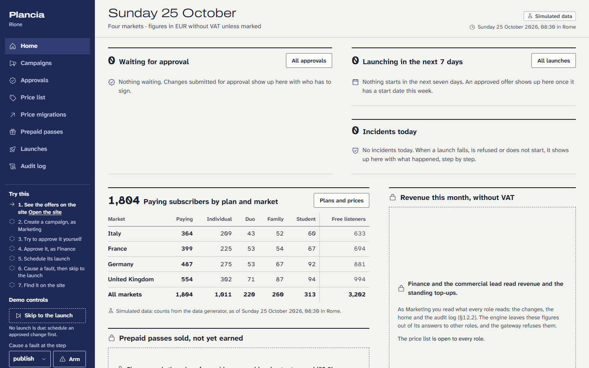
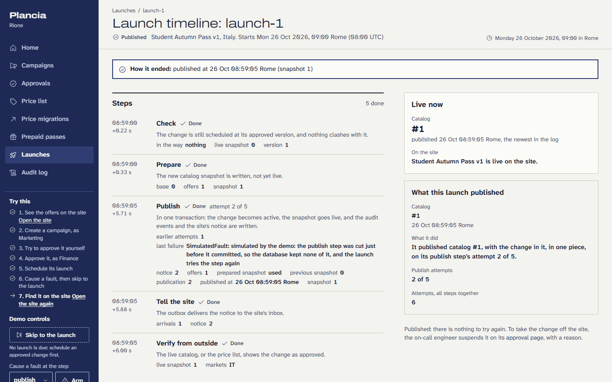

# The console

Where Rione's commercial team creates, simulates, approves and follows
changes: Next.js 16.4.0 built to static files, React 19, TanStack Query. Every
number on a page comes from the gateway's internal GraphQL API; nothing runs
on a server at request time.

> Independent personal project. Fictional business and synthetic customer
> data. No real payments are processed.

## What it does

- **Entry.** A person of the demo is chosen from the engine's list, by role.
  It is not a login: the gateway keeps the person in an HttpOnly session
  cookie, the browser never sends a role, and the CSRF token stays in the
  page's memory.
- **Home.** What waits for approval (with what each change does), what
  launches in the next seven days, today's incidents, who pays by plan and
  market, this month's revenue without VAT, the value of prepaid passes sold
  and not yet earned, and the week as lanes. Revenue is read by Finance and
  the commercial lead; the value not yet earned by Finance alone (§12.2,
  §9.2): by market, the codes sold, activated and expired unused, and their
  net value, with the total in euros at the declared rate. Every other role
  finds, in the same place, who reads them, and the console does not even ask
  for those figures in their name.
- **Campaigns.** The list, and a guided creation in five steps with the page
  beside it as the site would show it. Only Marketing creates and submits; the
  other roles read the same steps with the fields read-only, and a role that
  reviews finds the way to Approvals. A campaign can be for the fans of an
  artist (§14.2): the artist found in the catalog by a part of the name, more
  than a number of hours of their music, in a window of days (30 in the
  book). The engine counts them in the listening data once the version is
  saved and checked, and names them in the sentence of step 5.
- **Simulation.** The verdict first, then the assumptions with their sources,
  the break-even and who signs.
- **Approval.** What changed between versions, the finance conditions, the
  author's reason, the fingerprint; approve or send back after a confirmation
  that names the version and the fingerprint. The author finds no button and
  reads why; sending back is open to both roles that review, even on a
  version only Finance may sign. The same page serves every kind of change,
  and its evidence follows the kind: a campaign's simulation, a price
  migration's market rules and simulation, a pass's prices and periods.
- **Price migrations** (§8, §14.3). The commercial lead alone writes one in
  three steps like a campaign's: the new price for one plan in one market,
  the dates (when the existing subscribers are asked or told, when new
  subscribers pay it), then the check and the submission. Beside the form,
  the market's rules in two blocks that are never mixed: what the law asks,
  with its sources, and what Rione chose, labelled as a choice and not law
  (§8.1). The check shows the engine's findings (price, dates, overlap), each
  with the step that fixes it. The simulation (§8.7) says who pays what and
  from when, one subscription before and after, the revenue at risk at an
  acceptance declared as an assumption (90%, illustrative, changeable on the
  page), who would move to the Free plan, the prepaid passes it never
  touches, and conditions 1 and 5. Finance signs it, the commercial lead
  schedules it, and once its launch asked or told the subscribers, its
  progress shows how many were asked and who waits, accepted, declined or let
  the window run out (silence is no in Germany), read again every few seconds.
  A migration that started is not suspended: its price is in the price list,
  never edited (§4.2).
- **Prepaid passes** (§9, §14.4). The commercial lead alone writes one in
  the five steps of a campaign: the plan and months it gives (no Student
  pass: a gift code cannot carry a student verification), how long a code can
  wait, a fixed price, a period of sale and a page in each market, then the
  check and the submission, with the page beside it as the site would show
  it. Finance signs it as a price (condition 1), the commercial lead
  schedules it, and its launch puts it on sale.
- **Audit log.** Newest first, with filters, the chain's verification against
  an exported head, and the head's export. The page says §11.4 of the
  business book word for word.
- **Launches.** Every activation the engine ran, newest first, with a filter
  by state; and each launch's timeline: its five steps (done, running,
  failed, to be tried again, to do) with their times, attempts, last error
  and what they wrote; why it stopped or waits; what the site shows right
  now, which is the catalog of before until the publish step is done; how it
  ended; its incidents; the audit events it wrote. The on-call engineer tries
  a failed, refused or waiting launch again, or gives up one that has not
  published, after a confirmation that names the run; a reason is required
  to give up. An open incident (a change not live five minutes after its
  start, a launch failed or refused) is an alarm at the top of the home.
- **Price list**, read only.

Who may do what lives in one table, `src/lib/permissions.ts`: each role as
§12.1 writes it, the rights in the order the book names them, what every role
reads (§12.2) and who signs (§7.3). The menu, the entry and every lock compose
their sentences from it. The server decides all the same: the gateway applies
the same rights, the engine again, the database a third time for approvals.

## In the demo

The same console runs with no server in the demo (stage 8), at `/console/`
beside the site: built with `SANDBOX=1`, its pages live under the base path
`/console`, and its requests go to the demo's worker in the browser instead
of the gateway over HTTP, through the sandbox's own client
(`sandbox/client`): the same internal schema, the engine's own Python code,
the same migrations. Nothing above the transport changes (`src/lib/sandbox.ts`).
What differs is said on the screen:

- **The start.** The first visit starts the demo in this browser: the page
  shows the worker's steps as they happen, and a second tab of the site or
  the console is ready at once. A browser that lacks what the demo needs
  (WebAssembly, IndexedDB, workers) is told which, and what to use instead.
- **The demo's clock.** The console reasons with the demo's time, the
  story's, which runs at the machine's pace and jumps when the demo skips to
  a launch; the header shows it.
- **Try this**, in the rail: the recruiter's path in seven steps, each
  ticked when it happens, from the engine's facts (the campaign's state, its
  signature, its launch through a fault) and from what only this browser
  knows (the site opened, the approval page seen by its author).
- **The demo's controls**, in the rail: skip to the next launch due (the
  demo's clock moves to the change's start, its launch already run), a fault
  armed at one step of the next launch, simulated and said so (the real
  faults run on the full system, §14.6), and Start over.
- **The foot of every page**: where the data stays, and *About this sandbox*
  with Start over behind a confirmation; every tab reloads on the demo's
  first data.

The recruiter's path runs as a test on the assembled demo
(`e2e/demo.e2e.ts`, in the check's suite `demo`): two tabs, the console and
the site, from the first start to Start over, timed, with axe on every
screen and no request leaving the origin.

## Commands

From the repository's root:

| Command | What |
|---|---|
| `npm run console:stack` | the development database (the small generated data, up to the day it is loaded), the engine, the gateway and `next dev` on 127.0.0.1:4631 |
| `npm run build -w console` | the static export in `apps/console/out` (`scripts/build.ts`) |
| `npm run codegen -w console` | the typed operations from the gateway's schema and `src/graphql/operations`; `-- --check` compares |
| `node --test apps/console/test/*.test.ts` | the console's own logic under Node |
| `node apps/console/scripts/storybook-test.ts --build` | Storybook's build, then every interaction test in headless Chromium, with axe |
| `npm run storybook -w console` | Storybook on 127.0.0.1:4633, without opening a browser |
| `node apps/console/e2e/run.ts` | the end-to-end tests on the whole system: a throwaway database, the engine (from its fault-injection launcher, with the publish step of the first launch cut once), the gateway, the static build, Playwright |
| `npm run check -- --only design,console-types,console-codegen,console-unit,storybook,console-build,console-e2e` | the same, as suites with their floors |
| `SANDBOX=1 SANDBOX_BUILD=<build> npm run build -w console` | the console for the demo, under `/console` (`npm run demo:build` builds it with the site and the sandbox) |
| `node apps/console/e2e/demo.e2e.ts` with `DEMO_URL` | the recruiter's path on the assembled demo (`npm run demo:serve`) |
| `npm run photos -w console` | the photos of `docs/images/console-*`, taken again from the demo |

Ports come from the environment and are asked to the system before use:
`DEV_POSTGRES_PORT`, `CHECK_POSTGRES_PORT`, `ENGINE_URL`, `CHECK_ENGINE_PORT`,
`GATEWAY_INTERNAL_PORT`, `GATEWAY_PUBLIC_PORT`, `CONSOLE_PORT` (4631) and
`STORYBOOK_PORT` (4633). Playwright and Storybook run headless; requests
leaving 127.0.0.1 are refused and counted. Telemetry is off: Next.js through
`NEXT_TELEMETRY_DISABLED`, Storybook through `--disable-telemetry` and
`core.disableTelemetry`.

Four end-to-end tests schedule a real launch minutes away: an offer in
France, the Family rise in Germany, a prepaid pass in Italy, and the timeline
that reads the first of them. On the night a market's clocks go back (or
forward), its local times repeat (or do not exist) for an hour, and the
console and the engine rightly refuse a start at such a time (§3.7). Those
tests then are not run: each says why, and from what time (UTC) it can run
again, and the `console-e2e` suite reports "not run", never "passed".

## Next.js 16.4.0, and why not 16.4.1 yet

On 22 October 2026 three security advisories were published for Next.js:
one on Server Actions, one on the image optimization API with SVG, and one on
`use cache`. The fixed release, 16.4.1, came out less than two weeks ago, and
the repository only takes dependencies released before 10 October 2026. The
console stays on 16.4.0, because it uses none of the three:

- `output: "export"`: there is no Next.js server at all, so no Server Action
  endpoint and no image optimizer can be reached;
- no Server Actions in the code, `images.unoptimized: true`, no `use cache`;
- `experimental.agentUpgrade: false`: `next build` would otherwise ask the
  npm registry about upgrades on its own and stop with a `SecurityFatalError`;
  `agentRules: false` keeps `next dev` from writing instruction files into
  the app's folder.

**Before publication, move to 16.4.1 or later**, once it is old enough for
the dependency rule.

## Two workarounds, and where they end

- **Segment files on Windows.** Next.js 16.4.0 names each segment's prefetch
  file from a path it collects with the system's separator, so on Windows
  `out/campaigns/__next.campaigns/__PAGE__.txt` lands in a folder while the
  client asks for `/campaigns/__next.campaigns.__PAGE__.txt`: 404s in the
  console, and a full reload instead of a client-side navigation.
  `scripts/build.ts` moves the files to the names the client asks for; on
  Linux and macOS it finds nothing to move. Remove it when Next.js writes
  them right.
- **Storybook's App Router mock.** `@storybook/nextjs-vite` 10.6.1 provides a
  layout context older than Next.js 16.4, whose `useRouter` reads a render
  tree that context lacks. The framework runs in its pages mode, and
  `.storybook/preview.tsx` mounts the App Router's contexts itself: a router
  of spies, the pathname and the search parameters a story names.

## Motion

Reviewed in the format of the review-animations standards: nothing moves on
frequent or keyboard actions, every animation stays under 300 ms, and
reduced motion keeps short fades.

| Before | After | Why |
| --- | --- | --- |
| a button pressed with the keyboard (Space) jumped to `scale(0.97)` | no press transform while the person works from the keyboard | keyboard actions get no motion, not even an instant jump |
| the reduced-motion fade of the confirmation used the built-in `ease` | `var(--ease-out)`, the console's curve | a fade the person watches lands with the same curve as the rest |

What stays: the press of a pointer, `scale(0.97)` in 120 ms with
`cubic-bezier(0.23, 1, 0.32, 1)`; the confirmation dialog, opacity and
`scale(0.98)` in 220 ms from the centre, a 140 ms fade with reduced motion,
none from the keyboard; still shapes while loading, no spinner over content.
Verdict: approve.
